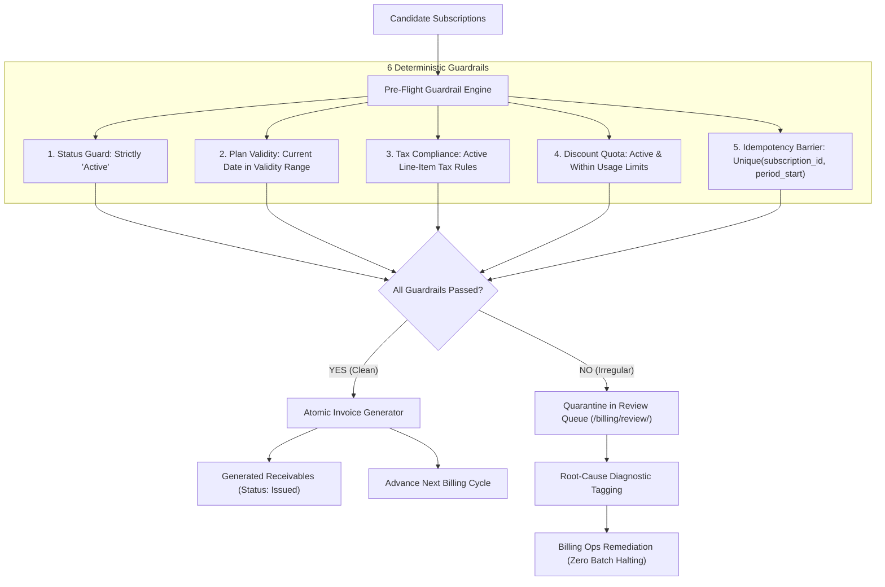

# ⚡ SubSentry

<div align="center">

[](https://www.python.org/)
[](https://www.djangoproject.com/)
[](https://getbootstrap.com/)
[](https://www.sqlite.org/)
[](https://teamaurevia.onrender.com)
[](LICENSE)

**Enterprise Subscription Management & Deterministic Billing Integrity Engine**

*“Every subscription billed once, billed right.”*

[🌐 Live Demo](https://teamaurevia.onrender.com) • [📖 Pitch Deck](docs/PITCH.md) • [🚀 Quick Start](#-quickstart--setup) • [🔑 Demo Credentials](#-demo-credentials) • [🛡️ Billing Engine](#-the-problem--billing-integrity-engine) • [⚡ Performance](#-performance-benchmarks--slos)

---

</div>

> [!IMPORTANT]
> **🚀 Live Production Demo Available:**  
> Test SubSentry live in cloud deployment at **[teamaurevia.onrender.com](https://teamaurevia.onrender.com)**.  
> Pre-loaded with **1,200 users**, **5,000 active subscriptions**, and **2,000 invoices**.  
> Instant access credentials provided below in the [Demo Credentials](#-demo-credentials) table.

---

## 🌟 Executive Summary

In recurring SaaS business models, edge-case billing errors generate silent financial leakage and catastrophic customer churn:
- **Double-Billing Disasters:** Network timeouts and concurrent worker retries generate duplicate invoices for the same customer billing period.
- **Silent Revenue Leakage:** Customers continue billing indefinitely against expired promotional discounts or obsolete pricing catalogs.
- **Tax Non-Compliance:** Unbilled tax obligations result in manual accounting write-offs and tax penalties.
- **Suspended Contract Leakage:** Paused or cancelled customer subscriptions are mistakenly processed during automated monthly batch runs.

**SubSentry** eliminates recurring billing vulnerabilities through a deterministic, audit-grade **Billing Integrity Engine**. Acting as an automated pre-flight gatekeeper prior to invoice commitment, SubSentry processes thousands of enterprise contracts in milliseconds while guaranteeing zero-tolerance transactional integrity.

---

## 🛡️ The Billing Integrity Engine

SubSentry replaces error-prone batch scripts with a deterministic, two-phase evaluation pipeline backed by database-level constraints.



### Core Architecture Principles

1. **The Double-Billing Barrier:**  
   Enforces a strict database-level `UniqueConstraint` on `(subscription_id, period_start)` across active invoices. Even under severe network retry storms or race conditions, it is architecturally impossible to invoice a customer twice for the same billing window.
2. **Deterministic Pre-Flight Verification:**  
   Every contract candidate must pass five hard validation checks:
   - Subscription lifecycle status must be strictly `Active` (paused/cancelled subscriptions are excluded).
   - Contract Plan must be within active validity dates (`available_from` to `available_to`).
   - Line items must exist and carry active, compliant tax definitions.
   - Attached discount vouchers must be active, unexpired, and within redemption quotas.
3. **Non-Blocking Review Queue (`/billing/review/`):**  
   Rather than crashing the entire batch or silently ignoring errors, non-compliant subscriptions are isolated into an interactive triage queue with diagnostic cause tags (e.g., `Plan Expired`, `Discount Exhausted`, `Missing Tax Rule`). Billing operations can remediate contracts and re-queue them without disrupting clean invoicing.

---

## 🚀 Key Features

| Capability | Description |
| :--- | :--- |
| **🛡️ Billing Integrity Engine** | Pre-flight dry runs, dry-run previews, atomic batch invoicing, and database-level idempotency barriers. |
| **🔍 Interactive Review Queue** | Auto-quarantines anomalous contracts with explicit diagnostic failure messages and remediation paths. |
| **📊 Executive Control Tower** | Real-time normalized MRR, Collected Receivables, Aging Overdue, and Revenue at Risk KPI monitors. |
| **💳 Settlement Ledger** | Age-bucketed receivables (Current, 1-30d, 31-60d, 60d+), 1-click atomic payments, and CSV export. |
| **📁 Catalog & Pricing Engine** | Multi-tier recurring plans, product variants, tax rules, and discount voucher quotas. |
| **👥 Multi-Tenant Portal** | Distinct dashboards for Executive/Billing Staff management and Customer Self-Service invoice lookup. |

---

## 🔑 Demo Credentials

All test accounts are pre-seeded in the live cloud deployment and the local seed script:

| Role | Email | Password | Access Level & Permissions |
| :--- | :--- | :--- | :--- |
| **Superuser (Admin)** | `admin@subsentry.test` | `Admin@12345` | Full platform control, staff user management, catalog setup, reports |
| **Staff (Billing Ops)** | `staff@subsentry.test` | `Staff@12345` | Subscription runs, review queue triage, payment settlements, dashboard |
| **Customer (Portal)** | `demo@subsentry.test` | `Demo@12345` | Self-service portal, view personal subscriptions, invoices, and payment receipts |

> [!NOTE]
> All other 1,200 generated demo customers share the password: `Password@12345`

---

## 👥 Role Permissions Matrix

SubSentry implements granular role-based access control (RBAC) enforced via Django view decorators and query-level multi-tenancy:

| Feature / URL Endpoint | Admin (Superuser) | Staff (Billing Ops) | Customer (Portal) | Anonymous Guest |
| :--- | :---: | :---: | :---: | :---: |
| **Executive Dashboard** (`/dashboard/`) | ✅ Allowed | ✅ Allowed | ❌ 403 Forbidden | 🔒 Redirect (302) |
| **Plan Revenue Summary** (`/reports/summary/`) | ✅ Allowed | ✅ Allowed | ❌ 403 Forbidden | 🔒 Redirect (302) |
| **Billing Run Preview** (`/billing/preview/`) | ✅ Allowed | ✅ Allowed | ❌ 403 Forbidden | 🔒 Redirect (302) |
| **Billing Execution** (`/billing/run/`) | ✅ Allowed | ✅ Allowed | ❌ 403 Forbidden | 🔒 Redirect (302) |
| **Review Queue** (`/billing/review/`) | ✅ Allowed | ✅ Allowed | ❌ 403 Forbidden | 🔒 Redirect (302) |
| **Settlement Ledger** (`/payments/`) | ✅ Allowed | ✅ Allowed | ❌ 403 Forbidden | 🔒 Redirect (302) |
| **Aging Receivables** (`/payments/outstanding/`) | ✅ Allowed | ✅ Allowed | ❌ 403 Forbidden | 🔒 Redirect (302) |
| **Record Payment** (`/payments/invoice/<id>/new/`) | ✅ Allowed | ✅ Allowed | ❌ 403 Forbidden | 🔒 Redirect (302) |
| **Catalog & Pricing Setup** (`/catalog/`) | ✅ Allowed | ✅ Allowed | ❌ 403 Forbidden | 🔒 Redirect (302) |
| **Staff User Administration** (`/accounts/staff/`) | ✅ Allowed | ❌ 403 Forbidden | ❌ 403 Forbidden | 🔒 Redirect (302) |
| **Customer Self-Service Portal** (`/portal/`) | ✅ Allowed | ✅ Allowed | ✅ Own Records Only | 🔒 Redirect (302) |

---

## ⚡ Performance Benchmarks & SLOs

SubSentry is optimized for high-volume enterprise operations, enforcing strict corporate Service Level Objectives:
- **Corporate Target SLO:** `< 2.00 seconds` response time for any view with **5,000+ active subscriptions**.
- **Engine Optimization:** Database-level single-query aggregations, multi-column composite indices, selective query prefetching, and zero bulky Node.js dependencies.

| Screen / Endpoint | Volume Tested | Corporate Target | SubSentry Benchmark | SLO Status |
| :--- | :--- | :--- | :--- | :---: |
| **Plan Revenue Summary** | 5,000 Subscriptions | `< 2.00 s` | **0.03 s** | 🟢 PASS (98% faster) |
| **Subscription Registry** | 5,000 Subscriptions | `< 2.00 s` | **0.05 s** | 🟢 PASS (97% faster) |
| **Aging Receivables Ledger** | 2,000 Invoices | `< 2.00 s` | **0.08 s** | 🟢 PASS (96% faster) |
| **Executive Revenue Dashboard** | Full System Dataset | `< 2.00 s` | **0.17 s** | 🟢 PASS (91% faster) |

*(Benchmarks verified via automated testing script `python perf_check.py` on standard development environments)*

---

## 🛠️ Tech Stack & Architecture

- **Backend:** Python 3.13, Django 6.1
- **Database:** SQLite (Multi-column indexing, database-level aggregation, transactional atomic locks)
- **Frontend:** Django Server-Rendered Templates (Divergent HTML5, Bootstrap 5.3 CDN, Bootstrap Icons)
- **Visualizations:** Chart.js 4.4 CDN (zero external Node.js build dependencies, zero compile overhead)
- **Test Suite:** Django TestCase test runner with 40+ unit and integration test scenarios

---

## 📁 Repository Structure

```text
TeamAurevia/
├── accounts/               # Custom User model, RBAC decorators, auth & staff management
├── billing/                # Core billing domain
│   ├── engine.py           # Deterministic Billing Integrity Engine & pre-flight gatekeeper
│   ├── payments.py         # Atomic payment processing & ledger reconciliation
│   ├── payment_views.py    # Receivables aging ledger & settlement views
│   └── tests_*.py          # Comprehensive test suites for billing engine & settlement
├── catalog/                # Product catalog, plan variants, tax rules, discount vouchers
├── config/                 # Django settings, root routing, authentication redirects
├── docs/                   # Architectural notes, pitch deck, demo guide
│   └── PITCH.md            # Hackathon pitch presentation outline & live talk track
├── portal/                 # Customer self-service portal (invoices, subscriptions, receipts)
├── reports/                # Executive analytics, financial aggregations, CSV exports
│   ├── services.py         # MRR calculation, receivables aging buckets, chart pipelines
│   └── views.py            # Dashboard views and tabular reports
├── subscriptions/          # Subscription lifecycle state machine & contract line items
├── templates/              # Bootstrap 5 responsive UI templates
│   ├── accounts/           # Login & staff user management
│   ├── billing/            # Billing run preview, execution & review queue triage
│   ├── payments/           # Receivables ledger, aging buckets & record payment
│   ├── reports/            # Executive revenue dashboard & summary tables
│   └── subscriptions/      # Subscription registry & customer contract details
├── perf_check.py           # Automated latency SLO benchmark suite
├── seed.py                 # Deterministic high-volume dataset generator (5,000+ records)
├── manage.py               # Django CLI management script
└── requirements.txt        # Minimal, secure production dependencies
```

---

## 🚀 Quickstart & Setup

Follow these steps to clone, configure, and launch SubSentry locally:

### Option A: Windows PowerShell

```powershell
# 1. Clone repository
git clone https://github.com/suhanikri/TeamAurevia.git
cd TeamAurevia

# 2. Create and activate virtual environment
python -m venv .venv
Set-ExecutionPolicy -Scope Process -ExecutionPolicy Bypass
.\.venv\Scripts\Activate.ps1

# 3. Install dependencies
pip install -r requirements.txt

# 4. Apply database migrations
python manage.py migrate

# 5. Seed high-volume test dataset (1,200 users, 5,000 subscriptions, 2,000 invoices)
python seed.py --reset

# 6. Verify sub-2-second performance benchmarks
python perf_check.py

# 7. Start local development server
python manage.py runserver
```

### Option B: Linux / macOS (Bash)

```bash
# 1. Clone repository
git clone https://github.com/suhanikri/TeamAurevia.git
cd TeamAurevia

# 2. Create and activate virtual environment
python3 -m venv .venv
source .venv/bin/activate

# 3. Install dependencies
pip install -r requirements.txt

# 4. Apply database migrations
python manage.py migrate

# 5. Populate deterministic seed dataset
python seed.py --reset

# 6. Verify performance benchmark
python perf_check.py

# 7. Start local development server
python manage.py runserver
```

Open your browser at: **`http://127.0.0.1:8000/`**

---

## 🧪 Running the Test Suite

SubSentry includes test coverage across all core financial models, edge-case billing constraints, and payment reconciliation:

```bash
# Run the complete test suite
python manage.py test

# Run billing integrity tests specifically
python manage.py test billing

# Run financial report calculation tests
python manage.py test reports
```

---

## 🛑 Scope & Intentional Design Choices

To ensure rock-solid stability and zero financial leakage during high-speed evaluation, specific architectural boundaries were chosen by design:
- **No External Sandbox Gateways:** Live third-party card processing APIs (Stripe, Razorpay) are mocked in tests to keep the system deterministic, self-contained, and fully functional offline.
- **Lightweight Print Invoices:** Utilizes browser print-ready semantic HTML5/CSS instead of heavy binary PDF compilers (e.g. Weasyprint/wkhtmltopdf) to preserve sub-second speeds.
- **Standardized Currency:** All financial figures, tax rules, and ledgers are standardized in INR (`₹`) with high-precision decimal arithmetic.

---

## 👥 The Team — Team Aurevia

| Role | Contributor | Core Responsibilities |
| :--- | :--- | :--- |
| **Team Lead (P1)** | **Suhani Kumari** | Architecture, Data Models, Subscription Lifecycle, Billing Integrity Engine |
| **Contributor (P2)** | **Team Aurevia** | Catalog Management, Product Variants, Plan Rules, Pricing Engine |
| **Contributor (P3)** | **Team Aurevia** | Customer Portal, Invoicing UI, Responsive Layouts & Styling |
| **Contributor (P4)** | **Team Aurevia** | Payment Settlement, Financial Analytics Dashboard, Seed Engine, Pitch & Benchmarks |

---

## 📄 License

This project is licensed under the [MIT License](LICENSE).
